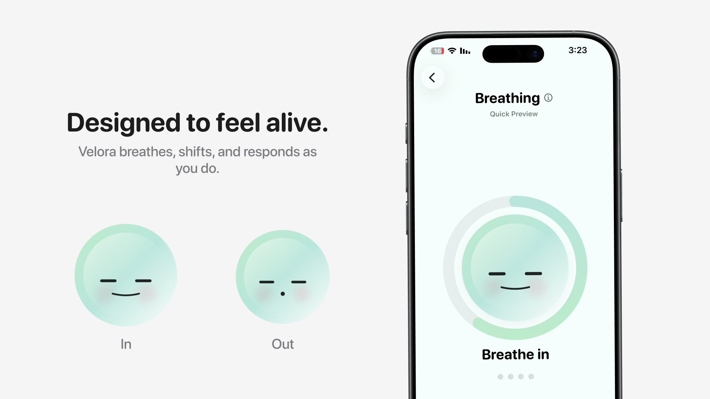
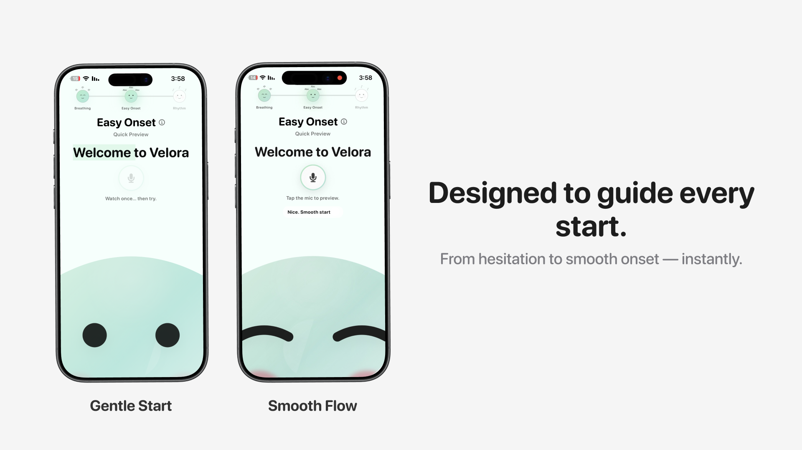
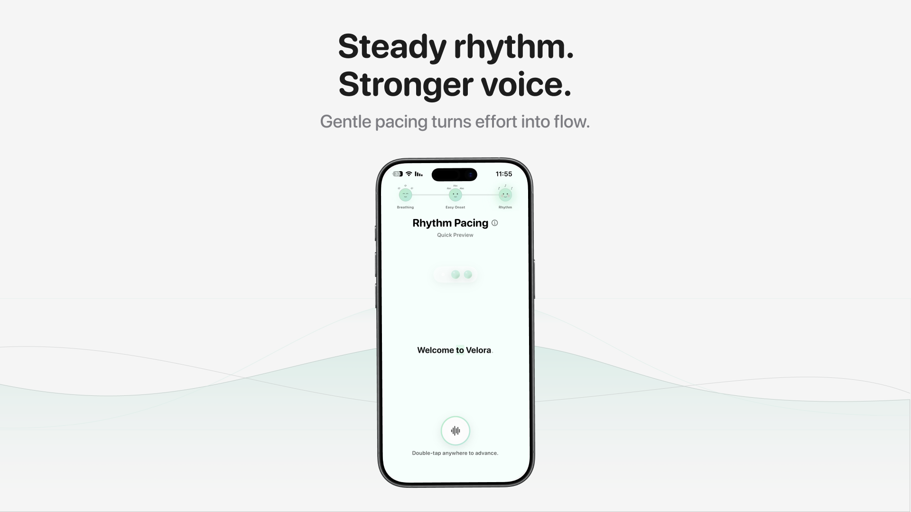

# Velora 🫧

**An emotionally supportive, offline speech-practice experience for people who stutter.**

Velora was developed for the **Swift Student Challenge 2026**. Instead of offering disconnected drills, it lets people rehearse real speaking situations with a gentle, expressive SwiftUI companion.

## Experience

1. **Onboarding and Home** — a calm introduction and one clear way to begin.
2. **Choose a topic** — 10 reading passages and 12 real-life scenarios, plus a custom-topic flow.
3. **Breathing** — a guided 60-second ritual (normal mode). The timer pauses if the app is inactive or backgrounded.
4. **Ready to Start** — a quiet transition before speaking.
5. **Easy Onset** — cumulative phrases build toward each complete sentence, with on-device speech recognition and a heuristic acoustic-onset check.
6. **Rhythm Pacing** — the same topic text, with subtle visual rhythm and word-by-word progress.
7. **Feedback** — supportive scores and optional playback of the Rhythm recording.

The exit confirmation is available during Breathing, Ready, Easy Onset and Rhythm, but not on the Feedback screen. Swiping down or choosing **Keep Practicing** returns to the session; **Leave Session** is the explicit exit action.

## Screenshots

| Breathing | Easy Onset | Rhythm |
|:--:|:--:|:--:|
|  |  |  |

## Built with

- Swift and SwiftUI, including the animated Velora character, gradients and visual feedback.
- Apple Speech (English US, on-device recognition required) and AVFoundation.
- Offline text normalization to tolerate common Apple Speech formatting variants such as contractions and digits.
- Temporary local Rhythm audio recording for feedback playback.
- UserDefaults for lightweight onboarding/technique-introduction preferences.

No sign-in, third-party SDKs, analytics service or network API is used by the app in this source tree. On-device speech-recognition availability and microphone permissions must be tested on supported hardware.

## Getting started

1. On a Mac with a compatible version of **Xcode**, open **`Velora.xcodeproj`**.
2. Select the **Velora** scheme and your iPhone/iPad as the destination.
3. Set your own Apple development team in **Signing & Capabilities** if required.
4. Run on a **physical device** for microphone and offline speech-recognition tests.

> **Release note:** Xcode currently contains `MARKETING_VERSION = 1.0`, `CURRENT_PROJECT_VERSION = 1` and an iOS deployment target of 26.1 at the app target level. Check your existing App Store Connect version/build before uploading an update; do not overwrite these values blindly.

## Verification

On a Mac with Swift installed, the existing offline checks can be run from the project root:

```bash
bash QualityChecks/RUN_CONTENT_AND_SPEECH_TESTS.command
bash QualityChecks/RUN_EASY_ONSET_DECISION_TESTS.command
bash QualityChecks/RUN_ONSET_EVIDENCE_TESTS.command
bash QualityChecks/RUN_ONSET_SMOKE_TESTS.command
```

These tests check deterministic logic, **not** end-to-end speech accuracy or animation quality on iPhone. A full Xcode Release build and physical-device regression test are still required.

## Project documentation

- [Architecture and file structure](docs/ARCHITECTURE.md)
- [Change history](CHANGELOG.md)
- [App Store release checklist](docs/APP_STORE_RELEASE_CHECKLIST.md)
- [GitHub publishing guide](docs/GITHUB_PUBLISHING.md)
- [Cleanup and verification record](docs/CLEANUP_REPORT.md)

## Important note

Velora is a supportive practice tool, **not a diagnostic device or a substitute for individualized speech-language therapy**. Its onset and session scores use app-specific heuristics and have not been clinically validated. Difficult speech should never be interpreted as personal failure.

## Creator

**Layan Allhidaan** — Swift Student Challenge 2026 project.
